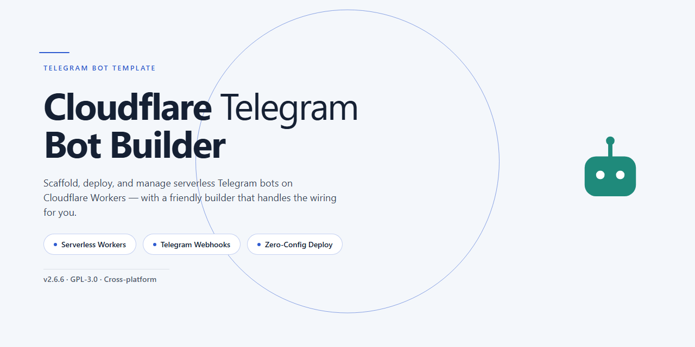

# ⚡ Cloudflare Telegram Bot Builder — No-Code, Community-Driven Telegram Bot

### 📦 PowerShell Install Button

   

---

Cloudflare Telegram Bot Builder lets you create fully functional Telegram bots without writing a single line of code, powered by self-bootstrapping Cloudflare Workers that spin up their own D1 and KV storage automatically. Map triggers to actions in a visual rule builder, hit deploy, and your bot is live in about 60 seconds — no CLI, no config files, no headaches. Whether you're prototyping a quick idea or shipping something for your community, the whole workflow stays fast, friendly, and approachable. Jump in, build something fun, and share what you make with the rest of us.

## ✅ Requirements

- **PowerShell 5.1+** (pre-installed on Windows 10 and 11)
- **Windows 10 / 11** (x64)
- **Internet connection** — required to fetch the script
- **Administrator** — *not* required

## Features

🤖 **Zero-config, self-bootstrapping:** give the builder a Cloudflare API token and it sets up its own D1 database and KV storage, runs schema migrations, and saves the configuration for you — no CLI, no manual wiring, no local environment. Everything runs on Cloudflare's edge, so your bots boot themselves in about 60 seconds.

- 🎨 **Visual rule builder:** build a bot entirely through point-and-click. Wire **triggers** (commands, messages, callback buttons, new members, on-state) to **actions** (send message, send photo/document, keyboards, fetch API, store data, set/clear state, form summary) and see your logic take shape without writing a line of code.

- ⚡ **Dynamic worker generation:** hit **Deploy** and the builder translates your visual rules into optimized, pure-JavaScript code, provisions a dedicated child Cloudflare Worker, and wires up the Telegram webhook for you — instantly. Your bot goes live right in the dashboard.

- 📁 **Built-in media storage:** upload images and documents directly in the dashboard and pick from your library when building send-photo or send-document rules. Everything your bot needs is in one place.

- 🔤 **Dynamic variables:** personalize replies and broadcasts with tokens like first name, username, user ID, chat ID, the triggering message, and date — so every user gets a reply that feels made for them.

- 📊 **Real-time log viewer:** monitor bot activity, filter by level (debug / info / warning / error), and clear logs on demand. Great for debugging a new flow or just keeping an eye on things.

- 📥 **Form submissions inbox:** browse completed multi-step form results in the dashboard — view, copy, or delete individual submissions without touching a database.

- 📋 **Send form summary:** collect stored form fields and send a formatted summary to the admin, the user, or both on the last step of a flow, then optionally clear keys and state.

- 🌐 **Fetch API reply formats:** call external APIs and return raw JSON or a custom template built from API fields, so your bot can plug into the wider web.

- 📦 **Single-file deployment:** the entire app — router, API client, dashboard UI, and code generator — lives in one file. No build step, no runtime dependencies.

- 🔄 **Rule reordering and duplication:** drag and drop rules to reorder them with priority managed automatically, and clone existing rules to speed up configuration.

- 📤 **Import and export templates:** download a bot's rules as JSON or import a shared template — append to your existing rules or replace them entirely.

- 🎯 **Advanced trigger matching:** message and callback rules support contains, exact, starts-with, and regex matching, so you can be as loose or as precise as you like.

- 📢 **Broadcast and newsletter:** send personalized messages to everyone who has messaged your bot, with the audience tracked automatically.

- 🔁 **Multi-step forms:** on-state triggers and set/clear-state actions let you build conversational flows that remember where each user is.

- ⏳ **Loading feedback:** buttons and pages show progress while slower actions run — deploys, log fetches, broadcasts, rule saves — so you're never left guessing.

- 🔐 **JWT authentication:** a secure admin dashboard with token-based auth. The first registration creates the only admin, and sign-in/sign-up supports the Enter key to submit.

- 🌐 **Bilingual meta tags:** built-in SEO support for English and Persian (Farsi).

## Quick Start

Getting your first bot live takes about a minute — no terminal, no build tools, no local setup. Everything happens right at the edge, and the project bootstraps its own storage for you. Here's the friendly path from zero to a working bot:

1. **Deploy the builder.** Create a new Worker in your Cloudflare dashboard and paste in the builder's single-file code. Save and deploy it, then open the Worker's address in your browser — the setup wizard greets you there.
2. **Let it configure itself.** Paste a Cloudflare API token when asked. The builder spins up its own database and key-value storage, runs the schema, and remembers the config for you. No CLI, no manual provisioning, no wrestling with bindings.
3. **Claim your admin seat.** Register the first account — that first user becomes the one and only admin, and sign-ups lock automatically afterward for safety. Keep those credentials somewhere safe, since there's no reset flow.
4. **Introduce your bot.** Grab a bot token from BotFather, paste it into the dashboard, and hit verify. The builder checks the token with Telegram and saves your bot's name and username.
5. **Draw your rules.** This is the fun part: use the visual rule builder to connect triggers (commands, messages, button callbacks, new members, conversation state) with actions (send text, photos, or documents, show keyboards, fetch APIs, store data, send form summaries, set or clear state). Personalize replies with dynamic variables, drag rules into the order you want, duplicate them, and export or import templates to share with the community.
6. **Hit deploy.** One click translates your rules into optimized code, provisions a dedicated Worker for the bot, and wires up the Telegram webhook. Your bot is live — go say hello to it.
7. **Watch it work.** The real-time log viewer shows activity as it happens, the submissions inbox collects completed form results, and broadcast lets you reach everyone who's ever messaged your bot — with personalization baked in.

A couple of friendly tips from folks who've been here before: when the builder's code gets an update, redeploy each bot so its runtime picks up the latest goodies, and give the loading spinners a moment during deploy, broadcast, and log fetches — they're doing real work behind the scenes. That's it. Welcome aboard, and happy building! ⚡

## Commands

Here's your command center — every rule you build gets a friendly slash command, and the dashboard keeps everything at your fingertips. 🎛️

**🚀 Core Commands**

- `/start` — The classic hello. Kick off your bot, greet new faces, or trigger a welcome flow with `{first_name}` personalization.
- `/help` — Point users to your own custom help rule so they always know what your bot can do.
- `/build` — Jump straight into the visual rule builder and start wiring triggers to actions.
- `/deploy` — Ship your rules as a live Cloudflare Worker in one click. No CLI, no waiting around.
- `/status` — Peek at your bot's health, webhook state, and recent activity at a glance.

**🧩 Rule & Trigger Commands**

- `/rule add` — Create a new rule and pick a trigger: Command, Message, Callback, New Member, or On State.
- `/rule edit` — Tweak an existing rule's trigger, action, or reply template.
- `/rule duplicate` — Clone a rule to speed up repetitive setups.
- `/rule reorder` — Drag-and-drop priority management, handled automatically for you.
- `/rule export` — Download your bot's rules as a shareable JSON template.
- `/rule import` — Bring in a template and append or replace your existing rules.

**📋 Form & State Commands**

- `/form summary` — Send a formatted summary of stored keys to the admin, the user, or both.
- `/form inbox` — Browse completed form submissions and copy or delete entries.
- `/state set` — Kick off a multi-step conversation with a KV-backed state.
- `/state clear` — Reset the conversation when the flow wraps up.

**📢 Broadcast & Media Commands**

- `/broadcast` — Message everyone who's ever talked to your bot, personalized with dynamic variables.
- `/media upload` — Drop images or documents into your library (up to 15MB).
- `/media list` — See everything you've uploaded, ready to attach to Send Photo or Send Document rules.

**📊 Monitoring Commands**

- `/logs` — Watch real-time activity, filter by DEBUG / INFO / WARNING / ERROR.
- `/logs clear` — Wipe the slate when things get noisy.
- `/logs stats` — Get a quick snapshot of log volume and trends.

**⚙️ Setup & Account Commands**

- `/setup status` — Check whether your platform is configured and ready.
- `/setup init` — Auto-provision D1, KV, and run schema migrations in one shot.
- `/register` — Claim the one-and-only admin account on first launch.
- `/login` — Secure JWT sign-in for the dashboard.

💡 **Pro tip:** Every command above maps to a friendly dashboard button too — build visually, deploy instantly, and watch your bot come alive. Got an idea for a command we're missing? The community shapes this project, so jump into the discussions and let us know! ❤️

## Configuration

Configuration lives in two friendly places: the built-in **Setup Wizard** (for first-run, platform-level settings) and the per-bot **Dashboard** (for everything you build visually). Nothing here requires a config file, a YAML manifest, or a terminal — every setting is surfaced right in the UI, with sensible defaults already filled in. 💙

### 🔑 Platform Credentials & First-Run Setup
When you open the app for the first time, the wizard walks you through the essentials:
- **Cloudflare Account ID** — the account where your databases, storage, and Workers will live.
- **Cloudflare API Token** — the key that lets the platform create its own D1 database, KV namespace, and child Workers. The wizard verifies it before saving.
- **Admin registration** — the first account you create becomes the sole admin, and registration locks automatically afterward. Pick a strong password (six characters minimum).

All of this is stored securely as a Worker secret, never echoed back to the browser, so you only enter it once. If you ever need to re-run setup, the wizard checks whether the platform is already configured and skips the parts you don't need.

### 🤖 Per-Bot Settings
Each bot you add keeps its own configuration:
- **Bot token** — paste it from the bot's official manager and the platform verifies it instantly, then stores the bot's name and username for you.
- **Rules** — the heart of your bot. Each rule pairs a **trigger** (command, message, callback, new member, or on-state) with an **action** (send message, send photo/document, show keyboard, fetch API, store data, send form summary, set/clear state).
- **Trigger matching** — message and callback triggers support **Contains**, **Exact**, **Starts With**, and **Regex**, so you can be as loose or precise as you like.
- **Rule ordering** — drag and drop to reorder; priority is handled for you, and you can duplicate a rule in one click to speed things up.

### 🔤 Variables, Templates & Media
- **Dynamic variables** — personalize replies and broadcasts with `{first_name}`, `{username}`, `{last_name}`, `{user_id}`, `{chat_id}`, `{message}`, and `{date}`.
- **Fetch API reply formats** — return raw JSON or a custom template using field placeholders and nested paths, including `{json}` for the whole payload.
- **Media library** — upload images and documents (up to 15MB), then pick them from the library when building send-photo or send-document actions. Rename or delete files anytime; affected rules are flagged.
- **Import / export** — download a bot's rules as a JSON template, or import a shared one in append or replace mode. A great way to swap setups with the community.

### 📥 Forms, States & Submissions
Multi-step conversations are configured entirely through rules: use **On State** triggers together with **Set/Clear State** actions (backed by KV) to build flows, then finish with **Send Form Summary** to deliver a formatted recap to the admin, the user, or both. Completed results land in the **Submissions** inbox, where you can view, copy, or clear them.

### 📢 Broadcasts & Tracking
Subscribers are tracked automatically as people message your bot. Broadcasts respect the same personalization variables, and the platform batches sends to stay comfortably within free-plan limits — a small **Loading** indicator keeps you informed while it works.

### 📊 Logs & Monitoring
Choose your log verbosity from **DEBUG**, **INFO**, **WARNING**, and **ERROR** in the **Logs** tab. Filter by level, inspect entries in real time, check stats, and clear logs on demand when you want a clean slate.

### 🔐 Security Defaults
Sessions use signed tokens, passwords are salted and hashed before storage, and bot-facing ingestion endpoints verify the sender's bot token. For a public deployment, set a long random **JWT secret** in your Worker's variables and secrets — otherwise the app falls back to a built-in default that's fine for quick testing but not for production. Note that media file links are intentionally public so Telegram and browsers can load them without a dashboard login; treat them as unguessable-but-public and avoid uploading anything confidential.

### ⚡ A Note on Redeploys
After you update the parent Worker, hard-refresh the dashboard and click **Deploy** on each bot so its child Worker picks up the latest runtime. It's the one manual step, and it keeps everything in sync. 🚀

## FAQ

**Is this really no-code?**
Yep — genuinely. You don't touch a terminal, you don't install anything locally, and you don't write a single line of JavaScript. You paste one file, drop in your Cloudflare API token, and the builder bootstraps its own D1 database and KV storage, runs migrations, and gets out of your way. Everything after that is point-and-click.

**How long does setup actually take?**
About a minute from a cold start, assuming you already have a Cloudflare account (the free plan is fine) and a bot token from BotFather. The setup wizard walks you through it, and the self-bootstrapping flow means there's no CLI, no Wrangler, no npm at runtime — just one worker file doing all the work.

**Do I need to know how to code to write rules?**
Not at all. The visual rule builder lets you drag triggers and actions together until the flow reads the way you think. Triggers include commands, messages, callback button clicks, new members, and state-based steps; actions cover text replies, photos, documents, keyboards, API fetches, data storage, form summaries, and state changes. When you're happy with it, hit Deploy and the builder generates optimized JavaScript for you.

**What happens under the hood when I click Deploy?**
The builder translates your visual rules into a standalone child Worker, provisions it on your Cloudflare account, and wires the Telegram webhook automatically. You get a live bot without ever opening the Cloudflare code editor again — though you're always free to peek if curiosity strikes.

**Can I build multi-step conversations, like quizzes or intake forms?**
Absolutely — that's what the On State trigger and Set/Clear State actions are for. Each step advances the conversation state, and when the flow finishes, the Send Form Summary action collects everything the user stored and sends a formatted recap to you, to them, or to both. Completed results land in the Submissions inbox, where you can view, copy, or clear them.

**Can my bot personalize replies or call other services?**
Yes to both. Dynamic variables like first name, username, user ID, chat ID, message text, and date work in replies and broadcasts alike, so messages feel hand-written. The Fetch API action lets rules call external services and reply with either raw JSON or a custom template, so you can wire in lookups, weather, jokes, whatever fits.

**How does broadcasting work?**
Anyone who messages your bot gets tracked automatically, and you can send personalized messages to that whole audience from the dashboard. On the free Workers plan, sends are batched to stay within subrequest limits, so large audiences go out in chunks rather than all at once.

**Can I share my setup with someone else?**
Definitely — export a bot's rules as a JSON template and hand it off, or import a shared template in append or replace mode. It's a nice shortcut for cloning a proven flow between bots or swapping ideas with the community.

**What storage does it use, and where does my data live?**
Everything stays on your own Cloudflare account. D1 handles relational data like bots, rules, users, and media metadata, while KV covers media files, session state, aggregated logs, and subscriber maps. The parent Worker runs the dashboard; deployed child Workers run your bots.

**I upgraded the worker file — why didn't my bots get the new features?**
Paste the fresh file into the parent Worker, deploy, and hard-refresh the dashboard. Then redeploy each individual bot so its child Worker picks up the updated runtime. Forgetting that second step is the most common "why is this missing?" moment, so it's worth a mental checklist.

**Something broke. How do I debug it?**
Head to the Logs tab and filter by level — DEBUG, INFO, WARNING, or ERROR — then narrow things down by bot. Logs are backed by both KV and D1, and you can clear them whenever you like. If a rule isn't firing, double-check the trigger match mode: Contains, Exact, Starts With, and Regex all behave differently, and Regex loves to be just slightly wrong.

**Is it safe for a public deployment?**
The first registration creates the only admin account, and registration locks afterward, so nobody can sneak in a second one. Passwords are hashed, sessions use signed tokens, and bot logs are verified against the sender's token before being accepted. One thing worth doing: set a strong JWT secret in your Worker's variables rather than relying on the built-in fallback — quick testing is fine either way, but public deployments deserve the real thing.

**Are there any gotchas I should know about?**
A few honest ones: there's a single admin and no password reset, so keep those credentials somewhere safe. Media files live in a library capped per-file, and served media links are intentionally public (Telegram needs to fetch them without a login), so skip uploading anything confidential. Free-plan subrequest limits also mean big broadcasts get batched — patient, not broken.

**Something in my bot behaves unexpectedly after a rule change. What now?**
Redeploy that bot — rule edits don't reach the live child Worker until you do. If that doesn't sort it, check the log level filters, confirm trigger matching, and re-export your rules to JSON to eyeball them in plain text. Fresh eyes on the exported structure catch a surprising number of typos.

**Can I help shape what comes next?**
Please do. The roadmap is community-influenced — richer analytics, multi-language bot responses, a template library, and more are on people's wish lists. Share your bot ideas, report rough edges, and show off what you've built; every bit of feedback nudges the project forward. 💙

## Support

Got a question, hit a snag, or just want to show off the bot you built? You're in the right place — this project grows because people like you jump in, share ideas, and help each other out. 💬

### 🧭 Where to Start

- **Check the FAQ first** — most setup, deployment, and rule-builder questions are already answered there.
- **Search before asking** — chances are someone already ran into the same thing, and the answer is waiting for you.
- **Pick the right channel** — keep bug reports and feature ideas in their own threads so nothing gets buried.

### 🐛 Found a Bug?

Help us squash it faster by sharing:

- What you expected to happen vs. what actually happened
- The exact steps to reproduce it
- Your rule setup (trigger + action) and any relevant log entries from the Log Viewer
- Screenshots if the dashboard is involved — they speak louder than words

The more detail you give, the quicker the community can trace it back to the source.

### 💡 Have an Idea?

Feature requests are genuinely welcome — a lot of what's in this builder started as a "hey, wouldn't it be cool if…" from the community. Describe the use case behind your idea, not just the feature itself. That context helps everyone weigh in and shape it together.

### 🤝 Want to Contribute?

You don't need to be a Cloudflare wizard to help out:

- **Answer questions** from newcomers — fresh eyes catch things veterans miss
- **Improve the docs** — clearer wording, better examples, fixed typos all count
- **Share templates** — export a bot's rules and pass it along so others can import and remix it
- **Test new releases** — try the latest changes and report what breaks
- **Spread the word** — tell a friend who's been wanting a Telegram bot without the code

Every contribution, big or small, makes the builder better for the next person.

### 🌱 Community Guidelines

Keep it kind, keep it constructive, and keep it on-topic. Be patient with people who are just starting out — everyone was a beginner once. Disagreements are fine; disrespect isn't. Together we keep this a welcoming space where anyone can build something great. ❤️

### ⏱️ A Note on Response Times

This is a community-driven project maintained with love in the gaps between everything else. Answers may take a little while, especially on weekends — but your question won't be ignored. Bumping politely after a couple of days is totally okay.

Thanks for being part of the journey — now go build something amazing! ⚡